<div align="center">

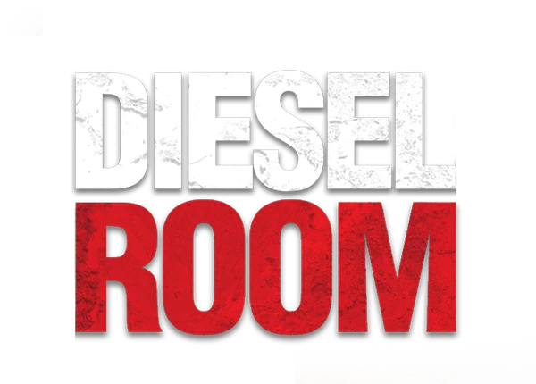

# VK Mini App программы лояльности

**Бар-ресторан «DIESEL ROOM», Пермь — баллы, подарки и гонка за призы внутри ВКонтакте**

Баллы за активность в группе и визиты по чекам · магазин из 16 подарков с QR-купонами · еженедельная гонка за призы
с проверочным кодом · онлайн-бронь столов · панель персонала с журналом аудита

[](https://github.com/RomanBukatov/VK-DieselRoom-MiniApp/actions/workflows/ci.yml)


</div>

<table>
  <tr>
    <td align="center">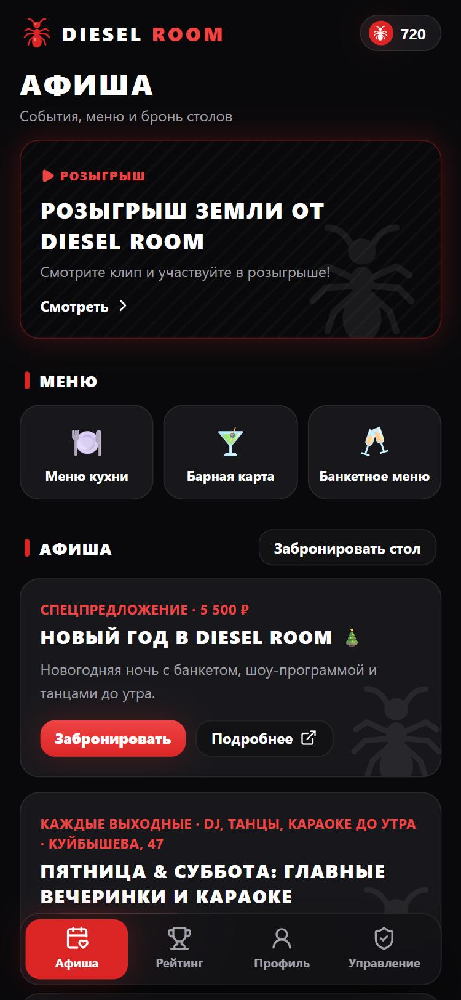<br><sub><b>Афиша</b><br>события с датами, бронь</sub></td>
    <td align="center">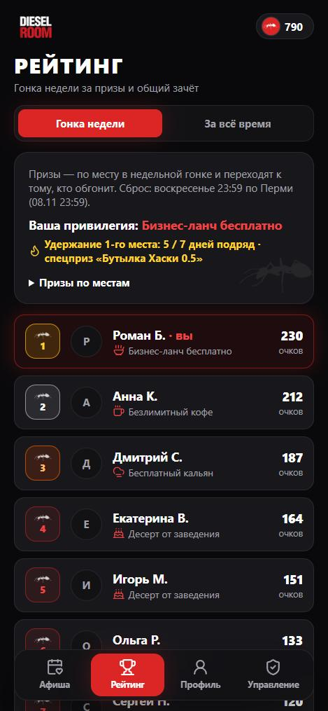<br><sub><b>Гонка недели</b><br>отсчёт и «до следующего места»</sub></td>
    <td align="center">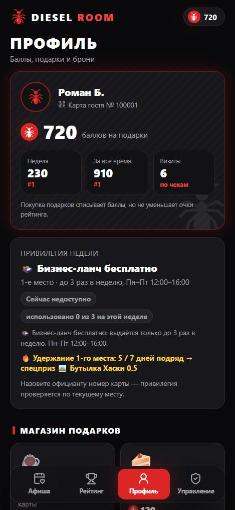<br><sub><b>Профиль</b><br>уровень и код привилегии</sub></td>
  </tr>
  <tr>
    <td align="center">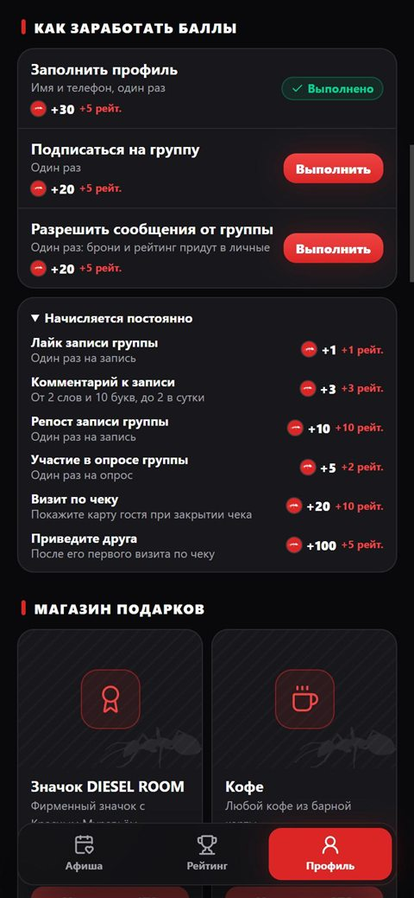<br><sub><b>Как заработать</b><br>задания со статусами</sub></td>
    <td align="center">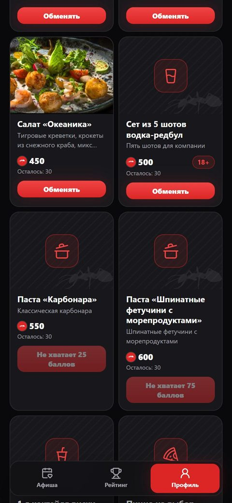<br><sub><b>Магазин</b><br>18+ и «не хватает N баллов»</sub></td>
    <td align="center">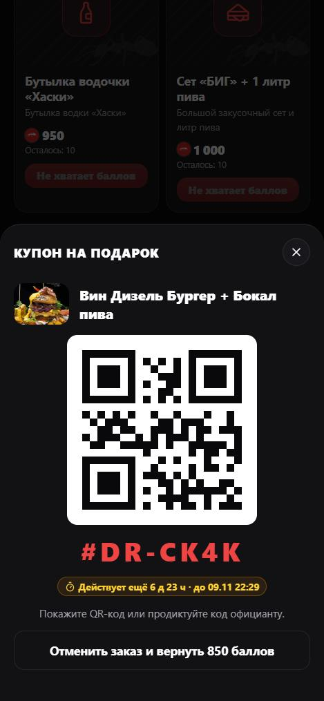<br><sub><b>Купон</b><br>QR-код на 7 дней</sub></td>
  </tr>
  <tr>
    <td align="center">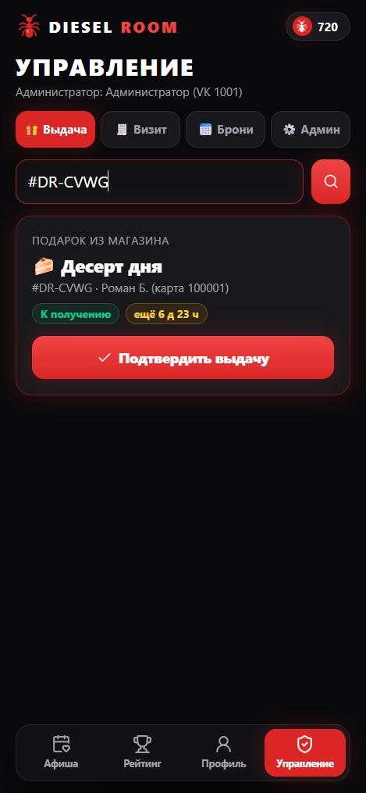<br><sub><b>Персонал</b><br>код совпал, сверка по фото</sub></td>
    <td align="center">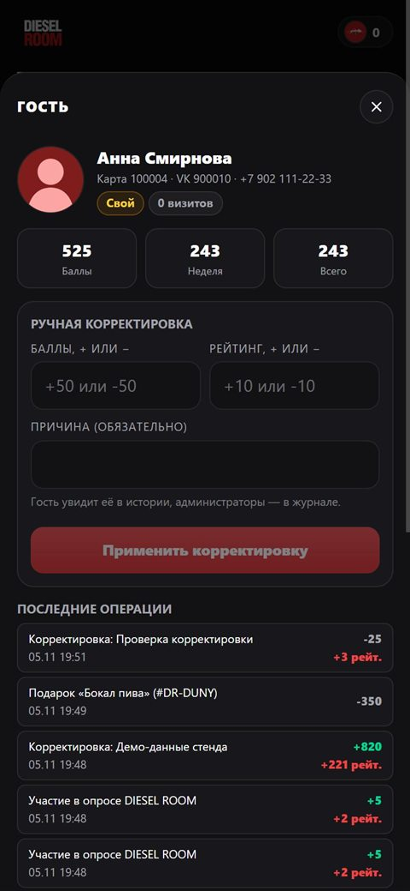<br><sub><b>Администратор</b><br>корректировка с причиной</sub></td>
    <td align="center">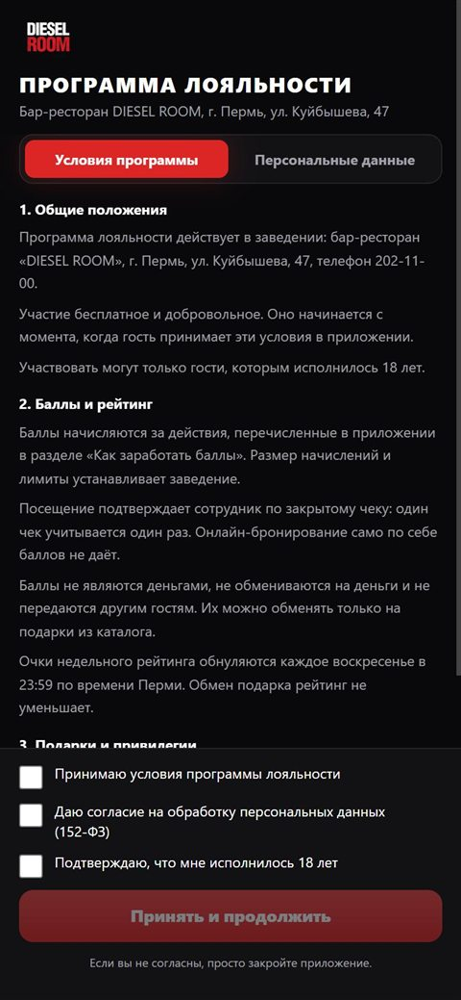<br><sub><b>Условия</b><br>согласие 152-ФЗ и 18+</sub></td>
  </tr>
</table>

## Возможности

### Для гостя
- **Условия программы** — при первом запуске гость принимает условия, согласие на обработку персональных данных (152-ФЗ) и подтверждает возраст 18+. Дата сохраняется в базе. До согласия сервер не хранит имя и фото, не принимает брони и обмен подарков, не начисляет баллы.
- **Афиша** — промо-баннер, плитки «Меню кухни», «Барная карта», «Банкетное меню» (ведут на официальные альбомы ВК, которые ресторан обновляет сам; банкетное скрывается после 31.12.2026), карточки событий с датой, маршрут и **бронь**: дата, время, гости, формат (зал, караоке, вечеринка, банкет), пожелания. Из карточки события форма сама подставляет его название, дату и формат. Подтверждение приходит сообщением от сообщества.
- **Рейтинг** — «Гонка недели» и «За всё время». Каждое место 1–50 даёт **переходящую привилегию**: от коктейля до бесплатного бизнес-ланча. Обогнал — забрал приз. Живой отсчёт до воскресенья 23:59, плашка «До следующего места X очков», трекер «Удержание 1-го места: X / 7» и спецприз за неделю лидерства.
- **Профиль** — кошелёк баллов, уровень с прогрессом (Гость → Свой → Резидент → Легенда Дизеля), **карточка привилегии с временным кодом и QR**, задания «Как заработать баллы», магазин, «Мои подарки» с QR-кодом и таймером, брони (активные и архив), «Приведи друга» со ссылкой и вводом кода, достижения, история начислений.
- **Сообщения от сообщества** — подтверждение и отказ по брони, «Вас сместили со 2-го места! Привилегия «Безлимитный кофе» больше недоступна…» (смещение во время паузы не теряется) и «До бесплатного кальяна (Топ-3) осталось всего 12 очков!» (одна цель — один раз в неделю).

### Как начисляются баллы

| Действие | Баллы | Рейтинг |
|---|---:|---:|
| Заполнить профиль: имя и телефон (разово) | +30 | +5 |
| Подписаться на группу, `group_join` (разово) | +20 | +5 |
| Разрешить сообщения от группы, `message_allow` (разово) | +20 | +5 |
| Участие в опросе группы, `poll_vote_new` (1 раз на опрос) | +5 | +2 |
| Лайк записи группы | +1 | +1 |
| Осмысленный комментарий (≥ 10 букв, ≥ 2 слов, до 2 в сутки) | +3 | +3 |
| Репост записи группы | +10 | +10 |
| Визит по закрытому чеку | +20 | +10 |
| Друг по ссылке `#ref=` или по коду — **после его первого визита** | +100 | +5 |

Ставки меняются в админке. Баллы тратятся на подарки, **рейтинг покупками не уменьшается**. Суточный лимит за лайки, комментарии и репосты считается по времени Перми (UTC+5). Подписку и разрешение сообщений подтверждает ВКонтакте: событием Callback API или ответом API ВК для тех, кто подписался раньше; за нажатие кнопки баллы не начисляются.

### Привилегии гонки недели

| Место | Привилегия | Когда |
|---|---|---|
| 1 | Бесплатный бизнес-ланч: суп, горячее, напиток, хлебная корзина | до 3 раз в неделю, Пн–Пт 12:00–16:00 |
| 2 | Безлимитный кофе | в любой день, пока гость на месте |
| 3 | Классический кальян **18+** | 1 раз в неделю, Пт/Сб |
| 4–10 | Десерт в подарок | 1 раз в неделю |
| 11–20 | Бокал разливного пива или кофе **18+** | 1 раз в неделю |
| 21–30 | Чайник чая на выбор | 1 раз в неделю |
| 31–50 | Бесплатный коктейль **18+** | 1 раз в 14 суток от прошлой выдачи, на вечеринках Пт/Сб |

**Как гость получает привилегию.** В профиле показан 6-значный код и QR: код меняется каждую минуту и срабатывает один раз. Официант сканирует QR или вводит код, сверяет крупное фото и имя с гостем и подтверждает выдачу. Без действующего кода сервер выдачу не примет, поэтому номера карты (он же реферальный код) для этого недостаточно.

### Магазин подарков

Официальный каталог DIESEL ROOM — 16 позиций. Купон `#DR-XXXX` с QR-кодом действует 7 дней; отмена или истечение срока возвращают баллы на баланс и подарок на склад. Алкоголь и кальян отмечены **18+**: официант видит напоминание проверить паспорт.

| Подарок | Баллы | | Подарок | Баллы |
|---|---:|---|---|---:|
| Значок DIESEL ROOM | 200 | | Пицца на выбор | 700 |
| Кофе | 300 | | Сет «Мини» | 750 |
| Бокал пива | 350 | | Брискет из говядины со шпинатным пюре | 800 |
| Бокал вина | 400 | | Вин Дизель Бургер + Бокал пива | 850 |
| Салат «Океаника» | 450 | | Кальян на фрукте | 900 |
| Сет из 5 шотов водка-редбул | 500 | | Бутылка водочки «Хаски» | 950 |
| Паста «Карбонара» | 550 | | Сет «БИГ» + 1 литр пива | 1000 |
| Паста «Шпинатные фетучини с морепродуктами» | 600 | | | |
| 1 л коктейля виски-кола | 650 | | | |

У блюд, которые есть на фотографиях меню, — оптимизированные превью (WebP, около 50 КБ, исходники в репозиторий не попадают). У остальных — фирменная заглушка: графитовый фон, водяной знак с Красным Муравьём и векторная иконка. Админ загружает фото любого подарка файлом прямо в редакторе каталога: приложение уменьшает его на устройстве, сервер проверяет содержимое файла и отдаёт его по постоянному адресу `/api/media/{id}`.

### Для персонала
- **Сотрудник** (официант, бармен, хостес — по VK ID или ПИН-коду на общем планшете): сканирование QR или ввод кода, выдача подарка и привилегии со сверкой по фото и напоминанием о паспорте для 18+, начисление визита по номеру чека, заявки на бронь с автообновлением и счётчиком ожидающих, памятка прямо в панели. О новой заявке и отмене брони персонал получает сообщение от сообщества. **Сотрудник не может начислить или выдать самому себе**: ни со своего телефона, ни по своему ПИН-коду, если в админке указан его VK ID. Администратор при приёмке проверяет чеки, подарки и привилегии на себе (следы остаются в журнале), но править себе баланс не может.
- **Администратор**: всё то же плюс афиша, баннер, ссылки меню, каталог, загрузка фото и остатки, ставки начисления, уровни гостя и **редактор достижений** (название, условие, показатель, цель, скрытие), **список гостей с поиском и ручной корректировкой** баллов и рейтинга (только с причиной), сотрудники с удалением и **журнал аудита** — кто, когда, кому и по какому чеку начислил или выдал.

## Дизайн

Индустриальный чёрно-красно-белый стиль: графитовый фон `#09090B`, карточки `#18181C`, фирменный красный `#DC2626`, контрастный капс в заголовках.
В интерфейсе нет эмодзи — только векторные иконки [lucide](https://lucide.dev), оригинальный логотип DIESEL ROOM (шапка и стартовый экран) и маскот — Красный Муравей (иконка валюты, маркеры мест в рейтинге, водяной знак на карточках).
Иконки подарков, плиток меню, привилегий и достижений хранятся на сервере как ключи (`coffee`, `pizza`, `burger`…), поэтому вид меняется без правки данных. Отсутствие эмодзи в исходниках проверяет отдельный тест.

## Надёжность там, где деньги

- **1 чек = 1 начисление** — уникальный индекс на `ReceiptNumber`; номер нормализуется (`a-555` и ` A-555 ` — один чек).
- **Покупка подарка** — `SELECT … FOR UPDATE` + условные `UPDATE`: баланс и остаток не уходят в минус при одновременных нажатиях.
- **Отмена и истечение купона** — переход статуса условным `UPDATE`, поэтому баллы и товар возвращаются ровно один раз (гостем, фоновой проверкой или при попытке выдачи).
- **Еженедельный сброс** в воскресенье 23:59 по Перми с архивом итогов; если сервер был выключен — догоняет при старте.
- **Антифрод Callback API** — секретный ключ, только своя группа, анти-копипаст, отсечка архивных постов, суточный потолок по времени Перми, уникальность начислений; разовые бонусы защищены тем же уникальным индексом.
- **Код привилегии** — HMAC от секрета сервера, гостя и номера минутного окна; повторное предъявление кода отклоняется даже для безлимитного кофе.
- **Ручная корректировка** — только с причиной, баланс не уходит в минус, запись и в истории гостя, и в журнале аудита.

Сценарии проверены не только в тестах, но и на реальном PostgreSQL: 8 параллельных покупок последнего подарка — 1 успех, 6 параллельных проведений одного чека — 1 успех.

## Архитектура

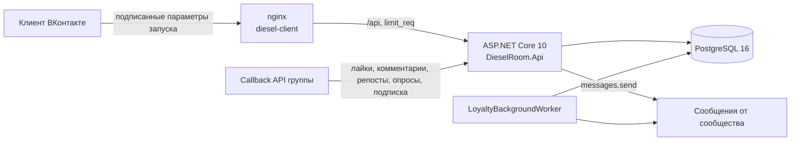

| Проект | Что внутри |
|---|---|
| [`DieselRoom.Domain`](DieselRoom.Domain) | Сущности и чистые правила: привилегии мест, время Перми (UTC+5), антифрод комментариев, коды купонов, достижения |
| [`DieselRoom.Infrastructure`](DieselRoom.Infrastructure) | EF Core и миграции, официальный каталог подарков, сервисы магазина, броней, визитов, рейтинга, привилегий и ролей, фоновый воркер |
| [`DieselRoom.Api`](DieselRoom.Api) | Контроллеры гостя, сотрудника и администратора, шлюз Callback API, проверка подписи VK, rate limiting |
| [`DieselRoom.Tests`](DieselRoom.Tests) | xUnit на SQLite in-memory (настоящие транзакции и уникальные индексы) + интеграционные тесты через `WebApplicationFactory` |
| [`diesel-client`](diesel-client) | React 19 + Vite 8 + Tailwind 4 + Zustand; QR-коды генерируются на клиенте |

Клиент собирается в **один JS-бандл без чанков** — старый iOS Safari во ВКонтакте периодически не догружает отдельные чанки. Ранний `VKWebAppInit` прямо в `<head>`, стек системной кнопки «Назад», SWR-кэш поверх отказоустойчивого `localStorage`, отступ шапки под кнопки мобильного клиента ВК.

## Быстрый старт

```bash
cp .env.example .env
```

Заполните в `.env` ключи VK, `DB_PASSWORD` и `DIESEL_PIN_PEPPER` (подробно — в [SECURITY.md](SECURITY.md)), затем:

```bash
docker compose up -d --build
```

| Сервис | Адрес |
|---|---|
| Клиент (nginx) | `http://127.0.0.1:3010` |
| API | `http://127.0.0.1:5062` |
| PostgreSQL | `127.0.0.1:5449` |

Callback API ВКонтакте: `https://<ваш-домен>/api/vk/callback`. В настройках группы включите события `wall_reply_new`, `like_add`, `wall_repost`, `group_join`, `message_allow` и `poll_vote_new`. Порты слушают только `127.0.0.1` — наружу проект открывается через nginx хоста с TLS; в нём тоже разрешите запросы до 4 МБ для загрузки фото (`client_max_body_size`).

Перед запуском дополните юридические тексты реквизитами оператора персональных данных ([`config/legal.ts`](diesel-client/src/config/legal.ts)) и покажите их юристу.

При первом старте база получает афишу, плитки меню и официальный каталог из 16 подарков. Существующая база переходит на этот каталог один раз: прежние позиции снимаются с витрины (выданные купоны сохраняются), недостающие добавляются.

## Разработка и тесты

```bash
dotnet test DieselRoomApp.slnx
```

```bash
cd diesel-client && bun install && bun test && bun run lint && bun run build
```

CI на каждый push проверяет бэкенд, фронтенд (линт, тесты, монолитность бандла), сборку Docker-образов и отсутствие секретов в истории ([gitleaks](https://github.com/gitleaks/gitleaks)).

## Безопасность

Ключей в репозитории нет — только переменные окружения. Подробности и как сообщить об уязвимости — в [SECURITY.md](SECURITY.md).
