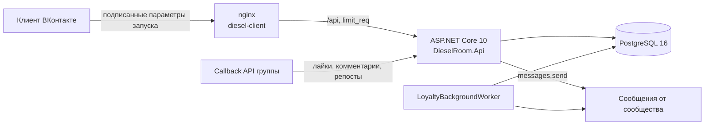

<div align="center">

# 🐜 DIESEL ROOM — VK Mini App

**Программа лояльности бара-ресторана «DIESEL ROOM» внутри ВКонтакте**

Баллы за активность в группе и визиты по чекам · магазин подарков с QR-купонами · еженедельная гонка за призы ·
онлайн-бронь столов · панель персонала с журналом аудита

[](https://github.com/RomanBukatov/VK-DieselRoom-MiniApp/actions/workflows/ci.yml)


</div>

<table>
  <tr>
    <td align="center"><br><sub><b>Афиша</b> · баннер, меню, события</sub></td>
    <td align="center"><br><sub><b>Гонка недели</b> · призы по местам</sub></td>
    <td align="center"><br><sub><b>Профиль</b> · баллы и привилегия</sub></td>
    <td align="center"><br><sub><b>Купон</b> · QR на 7 дней</sub></td>
    <td align="center"><br><sub><b>Персонал</b> · выдача по коду</sub></td>
  </tr>
</table>

## Возможности

### Для гостя
- **🎉 Афиша** — промо-баннер, плитки «Меню кухни / Барная карта / Банкетное меню» (банкетное скрывается автоматически по дате), карточки событий и **бронь стола**: дата, время, гости, формат (зал, караоке, вечеринка, банкет), пожелания. Подтверждение приходит сообщением от сообщества.
- **🏆 Рейтинг** — «Гонка недели» и «За всё время». Каждое место 1–50 даёт **переходящую привилегию**: от коктейля до бесплатного бизнес-ланча. Обогнал — забрал приз. Трекер «🔥 Удержание 1-го места: X / 7» и спецприз за неделю лидерства.
- **👤 Профиль** — кошелёк баллов, магазин подарков, «Мои подарки» с QR-кодом и таймером, брони, реферальная ссылка, достижения, история начислений.

### Как начисляются баллы

| Действие | Баллы | Рейтинг |
|---|---:|---:|
| ❤️ Лайк записи группы | +1 | +1 |
| 💬 Осмысленный комментарий (≥ 10 букв, ≥ 2 слов, до 2 в сутки) | +3 | +3 |
| ↗️ Репост записи группы | +10 | +10 |
| 🧾 Визит по закрытому чеку | +20 | +10 |
| 🤝 Друг по ссылке `#ref=` — **после его первого визита** | +100 | +5 |

Ставки меняются в админке. Баллы тратятся на подарки, **рейтинг покупками не уменьшается**.

### Для персонала
- **Сотрудник** (официант, бармен, хостес — по VK ID или ПИН-коду на общем планшете): выдача подарка по коду `#DR-XXXX`, выдача привилегии ранга с проверкой недельного лимита, начисление визита по номеру чека, обработка заявок на бронь.
- **Администратор**: всё то же плюс афиша, баннер, ссылки меню, каталог подарков и остатки, ставки начисления, сотрудники и **журнал аудита** — кто, когда, кому и по какому чеку начислил или выдал.

## Надёжность там, где деньги

- **1 чек = 1 начисление** — уникальный индекс на `ReceiptNumber`; номер нормализуется (`a-555` и ` A-555 ` — один чек).
- **Покупка подарка** — `SELECT … FOR UPDATE` + условные `UPDATE`: баланс и остаток не уходят в минус при одновременных нажатиях.
- **Отмена и истечение купона** — переход статуса условным `UPDATE`, поэтому баллы и товар возвращаются ровно один раз (гостем, фоновой проверкой или при попытке выдачи).
- **Еженедельный сброс** в воскресенье 23:59 по Перми с архивом итогов; если сервер был выключен — догоняет при старте.
- **Антифрод Callback API** — секретный ключ, только своя группа, анти-копипаст, отсечка архивных постов, суточный потолок, уникальность начислений.

Сценарии проверены не только в тестах, но и на реальном PostgreSQL: 8 параллельных покупок последнего подарка → 1 успех, 6 параллельных проведений одного чека → 1 успех.

## Архитектура



| Проект | Что внутри |
|---|---|
| [`DieselRoom.Domain`](DieselRoom.Domain) | Сущности и чистые правила: привилегии мест, время Перми (UTC+5), антифрод комментариев, коды купонов, достижения |
| [`DieselRoom.Infrastructure`](DieselRoom.Infrastructure) | EF Core и миграции, сервисы магазина, броней, визитов, рейтинга, привилегий и ролей, фоновый воркер |
| [`DieselRoom.Api`](DieselRoom.Api) | Контроллеры гостя, сотрудника и администратора, шлюз Callback API, проверка подписи VK, rate limiting |
| [`DieselRoom.Tests`](DieselRoom.Tests) | xUnit на SQLite in-memory (настоящие транзакции и уникальные индексы) + интеграционные тесты через `WebApplicationFactory` |
| [`diesel-client`](diesel-client) | React 19 + Vite 8 + Tailwind 4 + Zustand; QR-коды генерируются на клиенте |

Клиент собирается в **один JS-бандл без чанков** — старый iOS Safari во ВКонтакте периодически не догружает отдельные чанки. Ранний `VKWebAppInit` прямо в `<head>`, стек системной кнопки «Назад», SWR-кэш поверх отказоустойчивого `localStorage`, отступ шапки под кнопки мобильного клиента ВК.

## Быстрый старт

```bash
cp .env.example .env
```

Заполните в `.env` ключи VK, `DB_PASSWORD` и `DIESEL_PIN_PEPPER` (подробно — в [SECURITY.md](SECURITY.md)), затем:

```bash
docker compose up -d --build
```

| Сервис | Адрес |
|---|---|
| Клиент (nginx) | `http://127.0.0.1:3010` |
| API | `http://127.0.0.1:5062` |
| PostgreSQL | `127.0.0.1:5449` |

Callback API ВКонтакте: `https://<ваш-домен>/api/vk/callback`. Порты слушают только `127.0.0.1` — наружу проект открывается через nginx хоста с TLS.

## Разработка и тесты

```bash
dotnet test DieselRoomApp.slnx
```

```bash
cd diesel-client && bun install && bun test && bun run lint && bun run build
```

CI на каждый push проверяет бэкенд, фронтенд (линт, тесты, монолитность бандла), сборку Docker-образов и отсутствие секретов в истории ([gitleaks](https://github.com/gitleaks/gitleaks)).

## Безопасность

Ключей в репозитории нет — только переменные окружения. Подробности и как сообщить об уязвимости — в [SECURITY.md](SECURITY.md).
